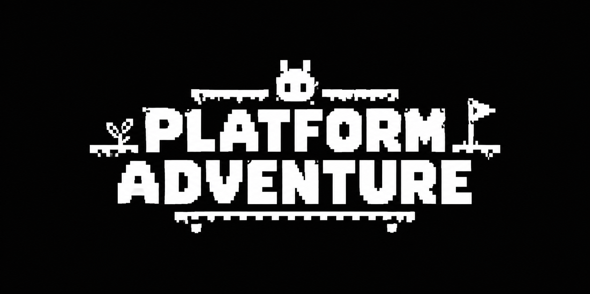

<div align="center">
  
  
  # Platform Adventure
  **Proyecto de Desarrollo de Videojuegos | Unity 6**
  
  *Un plataformas 2D modular construido sobre arquitectura orientada a eventos, principios SOLID, optimización física y Game Feel avanzado.*
</div>

---

## 🎯 Visión del Proyecto y Core Loop

**Platform Adventure** es un videojuego de plataformas bidimensional diseñado bajo estándares de ingeniería de software para cumplir con un **Core Loop cerrado y robusto**[cite: 8]:
1. **Inicio e Inicialización:** Carga y control de escenas coordinado sin interrupción del audio global.
2. **Gameplay y Progresión:** Progresión a través de 3 niveles estructurados (`Level_01`, `Level_02`, `Level_03`), integrando mecánicas de plataformas, navegación con salto, recolección de gemas/monedas, trampas físicas y combate con enemigos aéreos.
3. **Condición de Resolución:** Detección de meta mediante la gema de victoria, congelamiento de físicas del personaje y transición asíncrona cinematográfica (fundido a negro e interpolación de volumen).
4. **Ciclo de Reintento / Derrota:** Interacción con zonas de peligro, cálculo de daño y persistencia en el ciclo de juego sin bloqueos (*soft-locks*).

---

## 🛠️ Arquitectura de Software y Patrones de Diseño (Principios SOLID)

El proyecto erradica el código espagueti y las clases sobredimensionadas (*God Classes*) mediante una división estricta de responsabilidades:

### 1. Patrón Singleton
* **`GameManager`:** Instancia única que administra el estado de la sesión y la puntuación de monedas. Incorpora destrucción preventiva en `Awake()` ante colisiones de instancias.
* **`AudioManager` (Persistente):** Utiliza `DontDestroyOnLoad(gameObject)` para proveer un canal unificado de música y efectos a lo largo de todas las escenas, garantizando continuidad sonora.

### 2. Patrón Observer (Event-Driven Architecture)
* **Desacoplamiento Absoluto de UI:** La lógica central jamás busca referencias de objetos gráficos (`Text`, `Image`). 
* **Eventos Tipados de C#:** 
  * `public static event Action<int> OnPuntosCambiados;` para la sincronización reactiva del HUD al recolectar monedas.
  * Delegados de evento en `PlayerHealth` para notificar alteraciones de vida e impacto.
* **Control de Memoria y Ciclo de Vida:** La interfaz de usuario actúa como un receptor pasivo que se suscribe en `OnEnable()` y se desuscribe en `OnDisable()`, evitando fugas de memoria (*memory leaks*).
* **Suscripción al Engine:** `AudioManager` escucha el delegado nativo `SceneManager.sceneLoaded` para orquestar la música de fondo reactivamente al ingresar a un nuevo nivel.

### 3. Principio de Responsabilidad Única (SRP)
* `PlayerController`: Exclusivo para captura de inputs y traslación física[cite: 8].
* `PlayerAudio`: Módulo exclusivo para ejecutar clips sonoros de locomoción y salto.
* `PlayerHealth`: Gestión matemática de vitalidad, invulnerabilidad y lógica de daño.
* `PlayerFlash`: Modulación visual del canal alfa del *SpriteRenderer* ante impactos.

---

## 👾 Inteligencia Artificial y Físicas de Combate

### Enemigo Volador (*Flying Skull*)
* **Patrullaje Vertical Automático:** Cálculo de desplazamiento cíclico en el eje vertical (*ping-pong*) delimitado por puntos de control o temporizadores, ofreciendo un obstáculo dinámico en el aire.
* **Mecánica de Impacto y Knockback:** 
  * Al colisionar con el jugador, calcula el vector de dirección entre centros (`Vector2(player.x - enemy.x, ...).normalized`).
  * Aplica un impulso físico instantáneo (`AddForce` en modo `ForceMode2D.Impulse`) que repele al personaje para evitar recepciones de daño continuo por solapamiento.
  * Aplica una breve suspensión/aturdimiento momentáneo en la trayectoria del enemigo para dar retroalimentación clara de choque.

### Trampas y Obstáculos (*Spikes*)
* Configuración de colisionadores de tipo disparador (*Triggers*) con etiquetas dedicadas (`Trap`, `Spike`).
* Integración inmediata con `PlayerHealth.RecibirDanio(1)` al contacto, activando la rutina de parpadeo e invulnerabilidad temporal.

---

## ⚙️ Físicas 2D, Cámara y Game Feel ("Juice")

* **Separación de Ciclos de Ejecución:**
  * **Inputs (`Update`):** Procesamiento inmediato de teclas mediante el nuevo *Input System* (`Keyboard.current`), evitando pérdida de cuadros al saltar o girar.
  * **Físicas (`FixedUpdate`):** Aplicación de velocidad lineal directa (`rb.linearVelocity = new Vector2(...)`), asegurando un comportamiento de físicas uniforme e independiente de los FPS.
* **Composite Collider 2D:** Implementado en el `Ground_Tilemap` combinando `TilemapCollider2D` con `CompositeCollider2D` (modo estático y geometría poligonal). Erradica microbloqueos en bordes y optimiza drásticamente las llamadas del motor de físicas.
* **Cinemachine Virtual Camera:**
  * Encuadre suave con zonas muertas (*Dead Zones*) en el eje vertical para evitar saltos bruscos de cámara en micro-plataformas.
  * Anticipación de avance horizontal (*Lookahead*) y amortiguamiento (*Damping*).
  * **Screen Shake Procedural:** `PlayerController` dispara impulsos dinámicos mediante `CinemachineImpulseSource.GenerateImpulse(0.2f)` en saltos e impactos, transmitiendo peso e inercia real.
* **Animación Procedural en Gema de Victoria:** Oscilación senoidal programada en código (`Mathf.Sin(Time.time * freq) * amplitud`), reduciendo el consumo computacional y prescindiendo de dependencias de Animator para objetos pasivos.

---

## 🎮 Sistema Audiovisual y Cierre de Nivel

* **Transición Asíncrona de Escenas:**
  * Al recolectar la `GemaVictoria`, se bloquean los controles del jugador y se restringen las físicas en el `Rigidbody2D` (`FreezeAll`).
  * Ejecución de corrutina asíncrona (`IEnumerator TransicionCambioNivel`):
    * Dibuja un fundido a negro sobre la pantalla (`OnGUI`) mediante una textura generada en memoria de 1x1 píxeles para máxima eficiencia.
    * Realiza un *Fade Out* de la música con interpolación lineal (`Mathf.Lerp`).
    * Realiza el cambio de escena limpio hacia el siguiente nivel mediante `SceneManager.LoadScene()`.
* **Buses de Audio y Polifonía:** Separación de canales de música ambiental (*BGM*) y efectos de sonido (*SFX*), utilizando `PlayOneShot` para admitir múltiples efectos sonoros simultáneos (saltos, monedas, daño) sin corte de pista.

---

## 📦 Modularidad y Prefabs

El proyecto implementa una arquitectura basada en **Prefabs reutilizables**, permitiendo que cualquier nivel nuevo herede configuraciones completas sin duplicar trabajo en el editor[cite: 8]:
* `coin.prefab`: Coleccionable con lógica de puntuación y feedback.
* `Spike.prefab`: Trampa de daño con colisionador optimizado.
* `PanelVictoria.prefab`: Panel de interfaz escalado y anclado para el cierre de nivel.
* `Enemy_FlyingSkull.prefab`: Entidad enemiga con IA, colliders y parámetros preconfigurados.

---

## 📂 Estructura Modular de Scripts (SRP)

```text
Assets/
└── Scripts/
    ├── Audio/
    │   ├── AudioManager.cs         # Singleton persistente, reproductor de BGM/SFX y corrutinas de Fade (Lerp)
    │   └── PlayerAudio.cs          # Disparador desacoplado de eventos sonoros del personaje
    │
    ├── Core/
    │   ├── GameManager.cs          # Singleton y emisor Observer del estado de puntuación de sesión
    │   └── PlayerHealth.cs         # Gestor de vitalidad, invulnerabilidad y notificador de daño
    │
    ├── Enemies/
    │   └── FlyingEnemyAI.cs        # IA de patrullaje vertical aéreo y control de empuje (knockback)
    │
    ├── Player/
    │   ├── PlayerController.cs     # Controlador de locomoción física, inputs e impulso de Cinemachine
    │   └── PlayerFlash.cs          # Modulador cromático de invulnerabilidad temporal
    │
    ├── UI/
    │   ├── UIManager.cs            # Receptor pasivo (Observer) para actualización reactiva del HUD
    │   ├── MenuPrincipalManager.cs # Enrutador de carga y salida de escenas
    │   └── BotonRetroHover.cs      # Controlador visual de eventos de puntero (hover)
    │
    └── World/
        ├── Coin.cs                 # Notificador y disparador de puntuación coleccionable
        ├── Spike.cs                # Trampa de colisión física y desencadenante de daño
        └── GemaVictoria.cs         # Controlador de victoria, congelamiento de físicas y transición de escena